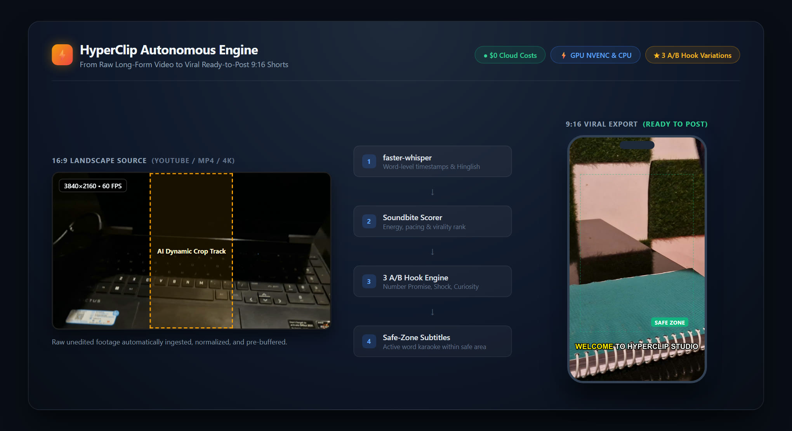
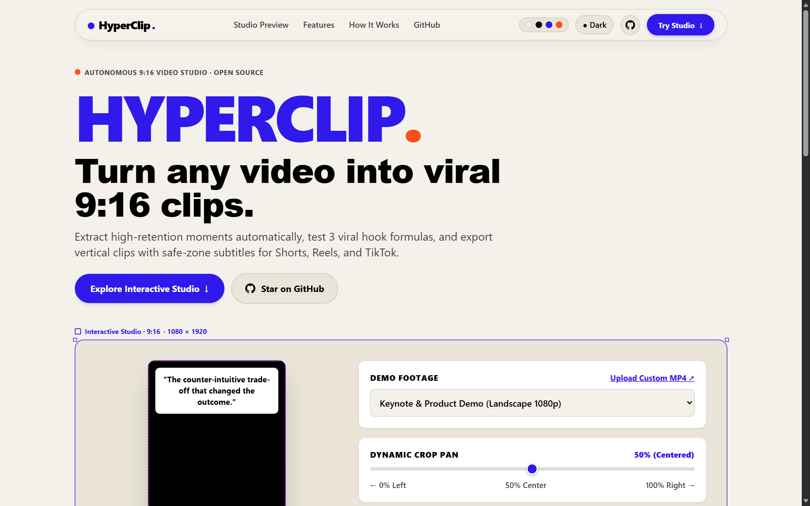

<p align="center">
  <h1 align="center">⚡ HyperClip</h1>
  <p align="center"><strong>The 100% Free, Local-First AI Video Clipper & Virality Engine</strong></p>
  <p align="center">Turn long-form videos & live streams into viral, ready-to-post 9:16 Shorts with animated karaoke subtitles, smart dynamic framing, and data-ranked A/B hooks. Zero cloud subscriptions. Unlimited minutes.</p>
</p>

<p align="center">
  <a href="https://github.com/Kartik-com/hyperclip/blob/main/LICENSE"></a>
  
  
  
  
  <a href="https://github.com/Kartik-com/hyperclip/pulls"></a>
</p>

---

<p align="center">
  
</p>

---

## 📌 Table of Contents

- [🔥 Why HyperClip?](#-why-hyperclip)
- [✨ Key Features](#-key-features)
- [📊 HyperClip vs The Competition](#-hyperclip-vs-the-competition)
- [🖥️ HyperClip Studio (Web GUI)](#️-hyperclip-studio-web-gui)
- [📐 Supported Framing Layouts](#-supported-framing-layouts)
- [🚀 Quick Start Guide](#-quick-start-guide)
  - [Prerequisites](#prerequisites)
  - [1-Click Windows Setup](#1-click-windows-setup)
  - [Manual Setup (Windows, Linux, macOS)](#manual-setup-windows-linux-macos)
  - [GPU Acceleration (Optional, Recommended)](#gpu-acceleration-optional-recommended)
  - [Free AI LLM Configuration](#free-ai-llm-configuration)
- [💻 Usage Guide](#-usage-guide)
  - [Option A: Web Studio GUI](#option-a-web-studio-gui)
  - [Option B: Autonomous CLI](#option-b-autonomous-cli)
  - [CLI Flags & Options](#cli-flags--options)
- [🏗️ Architecture & Pipeline](#️-architecture--pipeline)
- [🤝 How to Contribute](#-how-to-contribute)
- [🗺️ Roadmap](#️-roadmap)
- [📄 License & Author](#-license--author)

---

## 🔥 Why HyperClip?

Commercial tools like **OpusClip**, **CapCut Pro**, and **Klap** charge **$29–$49 every month**, limit your upload minutes, queue your renders on slow shared servers, and watermark your exports.

**HyperClip runs 100% locally on your machine:**
- 💸 **$0 Cloud Bills**: Local `faster-whisper` speech-to-text + free LLM options (Google Gemini Free Tier, Ollama, Groq, or FreeLLMAPI).
- ♾️ **Unlimited Minutes**: Clip 2-hour podcasts, 6-hour gaming streams, or interviews without quotas or paywalls.
- 🚫 **No Watermarks**: Your content is 100% yours.
- ⚡ **Lightning Fast NVENC GPU Encoding**: Utilizes your NVIDIA GPU for rapid video rendering, with automated multi-threaded CPU fallback for standard hardware.
- 🔒 **Complete Privacy**: Videos and audio never leave your local computer unless you explicitly connect a remote API.

---

## ✨ Key Features

- **🧠 Autonomous Soundbite Detection**: Transcribes video audio with word-level precision via `faster-whisper`. Automatically scores natural pauses, pacing, laughter, and high-energy statements.
- **🎣 3 Data-Ranked A/B Viral Hooks**: Every exported clip comes with 3 hook variations tested against viral shorts data:
  1. **Number Promise** (*2.46× avg retention*): `"Here are 3 signs you're on the right path..."`
  2. **Shock Fact** (*1.68× avg retention*): `"Nobody talks about what actually happens here..."`
  3. **Curiosity Gap** (*1.48× avg retention*): `"The moment it all clicked was completely unexpected..."`
- **🛡️ Safe-Zone Subtitle Shield**: Subtitles are rendered as high-contrast animated word-karaoke captions placed strictly inside the TikTok, Instagram Reels, and YouTube Shorts **Safe Zone**—preventing overlapping by app navigation, usernames, captions, and audio discs.
- **🗣️ Hinglish & Bilingual Ready**: Native phonetic handling for mixed English and Hindi/regional speech.
- **📱 Smart Dynamic 9:16 Crop**: Intelligent pan tracking that keeps the active subject in frame without manual keyframing.
- **🎨 Multi-Format Layout Compositor**: Solo speaker crop, stacked two-person podcast split, gaming streamer gameplay+webcam split, and cinematic blur letterbox.

---

## 📊 HyperClip vs The Competition

| Capability | OpusClip | CapCut Pro | Klap | **⚡ HyperClip** |
| :--- | :---: | :---: | :---: | :---: |
| **Price** | $29–$49/mo | $12/mo | $29/mo | **$0 (Free & Open Source)** |
| **Video Minutes** | 60–150 min limit | Metered | 100 min limit | **Unlimited** |
| **Watermark** | Yes (Free plan) | Yes | Yes | **None** |
| **Processing** | Remote Cloud Queue | Cloud / Local | Remote Cloud | **100% Local / Private** |
| **Hardware NVENC** | Cloud server | Basic | Cloud server | **Local NVIDIA GPU + CPU** |
| **A/B Hook Matrix** | Single title | Single title | Single title | **3 Data-Ranked Variations** |
| **Podcast 2-Person Stack** | Basic | Manual | Basic | **Automatic Dual Stack** |
| **Gaming Webcam Split** | Manual | Manual | ❌ No | **Automatic Game + Cam Split** |
| **Safe-Zone Subtitle Shield**| Partial | Manual | Partial | **Automated Safe-Zone Bounding** |

---

## 🖥️ HyperClip Studio (Web GUI)

HyperClip includes a built-in web studio for creators who prefer visual controls over terminal commands:

<p align="center">
  
</p>

- **Live 9:16 Preview Player**: Scrub video timeline and inspect word-level subtitle synchronization in real-time.
- **Interactive Crop Pan Slider**: Adjust horizontal crop positioning (`0%` to `100%`) on the fly.
- **A/B Hook Variant Selector**: Toggle between Number Promise, Shock Fact, and Curiosity Gap hook cards before rendering.
- **Safe-Zone Overlay**: Verify that subtitles and visual elements never touch platform UI elements.
- **Single-Click Export**: Queue renders directly to NVENC hardware encoding.

---

## 📐 Supported Framing Layouts

```
[ Solo Active Crop ]       [ Podcast 2-Person ]       [ Gaming Streamer ]
  ┌──────────────┐           ┌──────────────┐           ┌──────────────┐
  │              │           │  Host Cam    │           │   GAMEPLAY   │
  │    ( 👤 )    │           ├──────────────┤           ├──────────────┤
  │   Speaker    │           │  "CAPTIONS"  │           │  "CAPTIONS"  │
  │              │           ├──────────────┤           ├──────────────┤
  │  "CAPTIONS"  │           │  Guest Cam   │           │   Webcam 🎙️  │
  └──────────────┘           └──────────────┘           └──────────────┘
```

1. **Solo Active Crop (`--layout solo`)**: Dynamic 9:16 vertical crop focused on the active speaker with automatic pan smoothing.
2. **Podcast Dual Stack (`--layout podcast`)**: Stacks host on top and guest on bottom with subtitles centered on the seam divider.
3. **Gaming Streamer Split (`--layout gaming`)**: Stacks primary gameplay on top (65% height) with facecam below (35% height).
4. **Letterbox Blur (`--layout blur`)**: Preserves the complete 16:9 frame centered with a blurred, zoomed background fill.

---

## 🚀 Quick Start Guide

### Prerequisites
- **Python**: 3.10, 3.11, or 3.12 installed ([python.org](https://www.python.org/downloads/)).
- **FFmpeg**: Bundled automatically in `bin/` for Windows, or install via `winget install Gyan.FFmpeg` / `apt install ffmpeg` / `brew install ffmpeg`.
- **Git**: Installed on your system.

### 1-Click Windows Setup
The fastest way to install on Windows:
```cmd
git clone https://github.com/Kartik-com/hyperclip.git
cd hyperclip
install.bat
```
This automatically initializes the virtual environment, verifies Python and FFmpeg paths, and installs all core dependencies.

### Manual Setup (Windows, Linux, macOS)
```bash
# 1. Clone repository
git clone https://github.com/Kartik-com/hyperclip.git
cd hyperclip

# 2. Create virtual environment
python -m venv .venv

# 3. Activate virtual environment
# Windows (PowerShell):
.venv\Scripts\activate
# Windows (cmd.exe):
.venv\Scripts\activate.bat
# Linux / macOS:
source .venv/bin/activate

# 4. Install dependencies
pip install -r requirements.txt
```

### GPU Acceleration (Optional, Recommended)
If you have an **NVIDIA GPU**, install PyTorch with CUDA support for 5×–10× faster transcription and NVENC rendering:
```bash
pip install torch torchaudio --index-url https://download.pytorch.org/whl/cu121
```
*Note: If no NVIDIA GPU is detected, HyperClip automatically switches to high-speed multi-threaded CPU mode (`cpu` device + `libx264` encoder).*

### Free AI LLM Configuration
Copy `.env.example` to `.env`:
```bash
cp .env.example .env
```
Open `.env` and set your preferred AI provider:

```env
# OPTION 1: Google Gemini Free Tier (Fast & Free)
LLM_BASE_URL=https://generativelanguage.googleapis.com/v1beta/openai/
LLM_API_KEY=AIzaSy...your_gemini_key
LLM_MODEL=gemini-1.5-flash

# OPTION 2: Local Ollama (100% Offline & Free)
# LLM_BASE_URL=http://localhost:11434/v1
# LLM_API_KEY=ollama
# LLM_MODEL=llama3:8b

# OPTION 3: Groq Free Cloud Tier (Blazing Fast)
# LLM_BASE_URL=https://api.groq.com/openai/v1
# LLM_API_KEY=gsk_...
# LLM_MODEL=llama-3.1-8b-instant
```

---

## 💻 Usage Guide

### Option A: Web Studio GUI
Launch the visual editor:
```bash
python studio.py
# or double-click studio.bat on Windows
```
Then open **`http://localhost:8484`** in your browser.

### Option B: Autonomous CLI

#### 1. Process Local Video File
Drop your raw video into `input/` or provide its full path:
```bash
python run.py "input/podcast_episode_12.mp4" --layout auto --max-clips 3
```

#### 2. Process YouTube Video Directly
```bash
python run.py "https://www.youtube.com/watch?v=VIDEO_ID" --layout solo --max-clips 5
```

All rendered 9:16 vertical clips, animated subtitle tracks (`.ass`), titles, descriptions, and hashtags will be saved directly into `output/`!

### CLI Flags & Options

| Flag | Default | Description |
| :--- | :---: | :--- |
| `input` | *(required)* | Path to local `.mp4`/`.mkv`/`.mov` file or YouTube URL |
| `--layout` | `auto` | Framing layout: `auto`, `solo`, `podcast`, `gaming`, `blur` |
| `--max-clips` | `3` | Maximum number of viral soundbites to extract |
| `--min-duration` | `15` | Minimum clip length in seconds |
| `--max-duration` | `60` | Maximum clip length in seconds |
| `--whisper-model` | `base` | Whisper model size: `tiny`, `base`, `small`, `medium`, `large-v3` |
| `--device` | `auto` | Compute device: `auto`, `cuda`, `cpu` |
| `--output-dir` | `output` | Destination directory for rendered clips |

---

## 🏗️ Architecture & Pipeline

HyperClip executes a modular 5-stage pipeline designed for stability and speed:

```
[ 1. Ingest ] ──> [ 2. Transcribe ] ──> [ 3. AI Brain ] ──> [ 4. Layout & Sub ] ──> [ 5. Render ]
     │                   │                    │                     │                     │
Local File /         faster-whisper       LLM Soundbite         Face/Gameplay          FFmpeg NVENC
YouTube URL          Word Timestamps      Scoring & 3 Hooks     9:16 Compositor        H.264 / CPU
```

### Directory Structure

```
hyperclip/
├── assets/                  # Visual documentation assets & screenshots
├── bin/                     # Windows FFmpeg binaries (gitignored)
├── input/                   # Drag-and-drop raw input videos
├── output/                  # Exported 9:16 MP4s, ASS subtitles, and metadata
├── src/
│   ├── ai/                  # Soundbite detection, LLM client, virality scoring
│   ├── compositor/          # Dynamic framing engines (solo, podcast, gaming, blur)
│   ├── core/                # Pipeline orchestrator, video downloader, audio splitter
│   └── subtitles/           # Word-level karaoke generator & safe-zone bounds
├── web/                     # HyperClip Studio dashboard frontend
│   └── index.html           # Tailwind CSS + vanilla JS studio interface
├── install.bat              # 1-click Windows installer
├── run.py                   # Autonomous CLI pipeline entrypoint
├── studio.py                # Studio backend server (Starlette / uvicorn)
├── requirements.txt         # Python package dependencies
└── README.md
```

---

## 🤝 How to Contribute

We welcome contributions from creators, developers, video editors, and machine learning enthusiasts! Whether you want to fix a bug, add a layout compositor, or improve subtitle animation styles, here is how to get started:

### Development Workflow

1. **Fork the Repository** on GitHub: [github.com/Kartik-com/hyperclip](https://github.com/Kartik-com/hyperclip)
2. **Clone your fork locally**:
   ```bash
   git clone https://github.com/YOUR_USERNAME/hyperclip.git
   cd hyperclip
   ```
3. **Create a descriptive feature branch**:
   ```bash
   git checkout -b feature/animated-broll-cutaways
   ```
4. **Set up your development environment**:
   ```bash
   python -m venv .venv
   .venv\Scripts\activate   # or source .venv/bin/activate
   pip install -r requirements.txt
   ```
5. **Run test verification**:
   ```bash
   python -m unittest discover tests/
   ```

### Areas Where We Welcome PRs

- 🎨 **New Subtitle Styles**: Add modern font presets in `src/subtitles/ass_generator.py` (e.g., Hormozi yellow box, MrBeast bouncy pop, sleek minimalist).
- 📐 **New Video Compositor Layouts**: Create layout plugins in `src/compositor/` (e.g., reaction facecam PIP, 3-person round-table split).
- 🎙️ **Speaker Diarization**: Integrate PyAnnote / Silero VAD to detect speaker switches in multi-person interviews.
- 🎬 **Automated B-Roll Insertion**: Hook up free stock footage or meme overlays based on spoken keywords.
- 🌐 **Studio UI Features**: Add waveform scrubbing, interactive subtitle re-timing, and drag-and-drop crop boxes in `web/index.html`.

### Pull Request Guidelines
- Keep code clean, readable, and PEP 8 compliant.
- Ensure cross-platform compatibility (do not hardcode Windows-specific or Linux-specific paths).
- Include clear descriptions and before/after screenshots in your PR if modifying UI or video output.

---

## 🗺️ Roadmap

- [x] Autonomous 16:9 to 9:16 vertical layout conversion
- [x] Word-level highlighted karaoke subtitles with ASS styling
- [x] TikTok, Instagram Reels, and YouTube Shorts Safe-Zone bounds
- [x] 3 Data-backed A/B viral hook variants per clip
- [x] Local GPU NVENC hardware acceleration with automatic CPU fallback
- [x] Interactive HyperClip Studio Web GUI
- [x] Windows 1-click installer (`install.bat`)
- [ ] Automated stock B-roll & meme overlay insertion
- [ ] AI speaker diarization (voice-based active speaker switching)
- [ ] One-click direct social publishing (TikTok, Shorts, Reels API)
- [ ] Real-time audio noise suppression (DeepFilterNet integration)

---

## 📄 License & Author

Distributed under the **MIT License**. See [`LICENSE`](LICENSE) for complete details.

Created with ❤️ by **[Kartik Shingade](https://github.com/Kartik-com)**.

⭐ **If you find HyperClip useful, please star the repository on GitHub!** It helps the project grow and stay 100% free.
